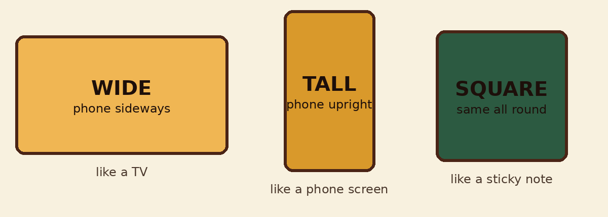

# Tomorrow at Jack O'Beers

**Do this first (2 min):** charge the iPhone and the Pocket 3. Put a fast microSD card (V30 or better) in the Pocket 3.

Shop: 13 Station Road, Milngavie, G62 8PG. Open 11am to 7pm, Wednesday to Monday.

## The day in 6 steps (about 3 hours)

1. Ask 5 questions (15 min)
2. Photograph the pint, 6 frames (30 min)
3. Photograph the keezer, 6 frames (30 min)
4. Film 5 clips (45 min)
5. Photograph products and the shop (60 min)
6. Back up and leave (10 min)

---

## Shape rule: hold the phone sideways

**Wide** is longer than it is tall (also called landscape). **Tall** is taller than it is wide (portrait). **Square** is the same height and width.

**Everything is WIDE (phone sideways) except products and hampers, which are SQUARE.**
On a phone screen the site shows only the middle strip of each wide picture. So keep the important part in the **middle half**, and leave empty space round it. I crop to size later.

**Photos (iPhone 16 Pro Max, main lens)**

| Photo | Shape | Keep in the middle | Goes on |
|---|---|---|---|
| Pint, 6 frames | Wide | Glass and foam | Beers page background |
| Keezer, 6 frames | Wide | Taps and glass | Keezer page background |
| Each product | Square | Product centred, space all round | Shop cards, product pages, Shopify |
| Each hamper | Square, from above | Hamper centred | Hampers page, Shopify |
| Deli, inside, shop front | Wide | Nothing important at the edges | Home, Deli, About |
| Team (if they agree) | Tall, plus 1 wide group | Face in the top third | About |

**How to shoot square on the iPhone:**

1. Open the Camera app
2. Tap the small arrow at the top of the screen
3. Tap the shape button (it says 4:3) and pick **1:1**. That is square.

Cannot find it? Shoot normally and leave space round the product. I crop it square.

**Video (Pocket 3, 4K)**

| Clip | Shape | Keep in the middle | Goes on |
|---|---|---|---|
| Hero pour (slow motion) | Wide | Glass in the centre, dark calm background, nothing in the bottom third | Home page, full screen |
| Walk-through | Wide | Subject centred | Home, About |
| Deli counter, hands only | Wide | Hands and food | Deli page |
| Hamper packing, from above | Wide | Hamper centred | Hampers page |
| Shop front, locked off | Wide | Sign centred | About, Contact |

**Optional, not for the website:** film the hero pour again tall (9:16) for Instagram Reels and YouTube Shorts.

**File names:** `beer-1` to `beer-6`, `keezer-1` to `keezer-6`, `product-name-1`, `hamper-name-1`, `hero-pour-1`, `walkthrough-1`.

---

## 1. Ask 5 questions (15 min)

- [ ] Is Tuesday open? What are the final opening hours?
- [ ] Can they send the logo as a vector file (SVG, AI or PDF), plus the brand colours?
- [ ] What is the keezer exactly (chest freezer with taps?), and how many kegs per unit?
- [ ] Is the Shopify store live, and who can create the access token? Never share passwords.
- [ ] Does the premises licence cover delivery? Ask to see the operating plan.

Write the answers next to each one.

---

## 2. Pint photos: 6 frames (30 min)

Same glass, same spot, nothing moved between frames.

1. Tripod. Lock focus, exposure and white balance. **Wide (phone sideways).** Glass and foam in the middle half.
2. `beer-1`: full pint with foam head
3. `beer-2`: about 80% left, `beer-3`: 60%, `beer-4`: 40%
4. `beer-5`: 20%, `beer-6`: empty with foam on the glass
5. Take 3 shots of each stage. Do not touch the camera.

Use the iPhone, main lens, 12 MP.

---

## 3. Keezer photos: 6 frames (30 min)

Same method. **Wide.** Taps and glass in the middle half, in the same place in every frame.

1. `keezer-1`: empty glass under the tap
2. `keezer-2` to `keezer-5`: glass filling in four steps
3. `keezer-6`: full pint with foam head

---

## 4. Film 5 clips (45 min)

Each clip 10 to 20 seconds. No talking. No music playing in the shop.

**Pocket 3 settings:** 4K, 25 fps, Normal colour (not D-Log), shutter 1/50, white balance set by hand.
**iPhone settings:** 4K 25 fps, HDR Video off, main lens, lock exposure.
**Slow motion:** Pocket 3 Slow Motion, 4K 120 fps.

1. Hero pour: beer into a glass, slow motion. **Wide.** Glass centred. Shoot 3 takes.
2. Walk through the shop, slow, Pocket 3 Follow mode. **Wide.**
3. Deli counter: hands only, cutting cheese or lifting a pie.
4. A hamper being packed, from above.
5. Shop front, locked off, in daylight. **Wide.**

---

## 5. Products and shop photos (60 min)

1. Every product, front-on, on a plain light card. **Square**, product in the middle
2. A close-up of every label (ABV and allergens come from the label)
3. Deli items (wide) and every gift hamper (**square**, from above)
4. Shop front, inside, the counter, the taps (**wide**)
5. The signage and anything showing the brand colours

---

## 6. Back up and leave (10 min)

1. Copy everything to the laptop. Do not send by WhatsApp or messages.
2. Copy it again to a second place.
3. Write down which file is which.
4. Tell them what happens next: you send the preview, they send the answers.

---

## Later, if there is time

- [ ] Team portraits (only people who agree)
- [ ] Their Instagram, YouTube and Google page links
- [ ] Menus, leaflets and price lists (photograph them flat)
- [ ] Product details: size, price, tasting notes
- [ ] A 30 second "who we are" clip

---

## Good to know

- Film in 4K. The website uses a 1080p copy, which I make. Do not upload 4K.
- Keep every original file untouched.

**Next:** charge both cameras now.
