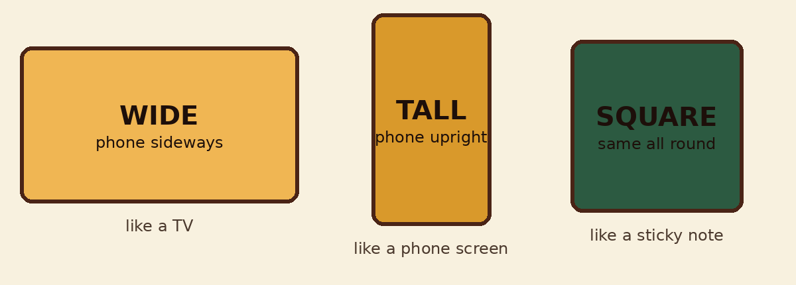

# What to shoot, with what

**Do this first (2 min):** set both cameras below, then start.

- **iPhone video:** 4K, 25 fps, HDR Video off
- **Pocket 3:** 4K, 25 fps, Normal colour, shutter 1/50

**Wide** = phone sideways. **Square** = Camera app, small arrow at the top, tap 4:3, pick 1:1. **Tall** = phone upright.

---

## iPhone: take PHOTOS of these 5 things

| # | Photo of | Format | Name the files |
|---|---|---|---|
| 1 | The pint, 6 stages (full to empty) | **WIDE**, on a tripod | `beer-1` to `beer-6` |
| 2 | The keezer, 6 stages (empty to full) | **WIDE**, on a tripod | `keezer-1` to `keezer-6` |
| 3 | Every product, front on | **SQUARE** (1:1) | `product-name-1` |
| 4 | Every gift hamper, from above | **SQUARE** (1:1) | `hamper-name-1` |
| 5 | Shop front, inside, deli counter | **WIDE** | `shop-1`, `deli-1` |

---

## Pocket 3: FILM these 5 clips

Each clip 10 to 20 seconds. No talking. No music in the shop.

| # | Film | Format | Mode |
|---|---|---|---|
| 1 | A pour into a glass (the hero) | **WIDE**, glass in the middle, tripod | **Slow Motion, 4K 120 fps**. 3 takes. |
| 2 | Walk through the shop | **WIDE** | 4K 25 fps, **Follow** mode |
| 3 | Deli counter, hands only | **WIDE** | 4K 25 fps |
| 4 | A hamper being packed, from above | **WIDE** | 4K 25 fps |
| 5 | Shop front, daylight | **WIDE**, tripod | 4K 25 fps |

---

## Only if there is time

- iPhone: **TALL** photos of the team (only people who agree)
- iPhone: film the pour again **TALL** for Instagram (not for the website)

---

**Next:** set the iPhone and the Pocket 3 now.
